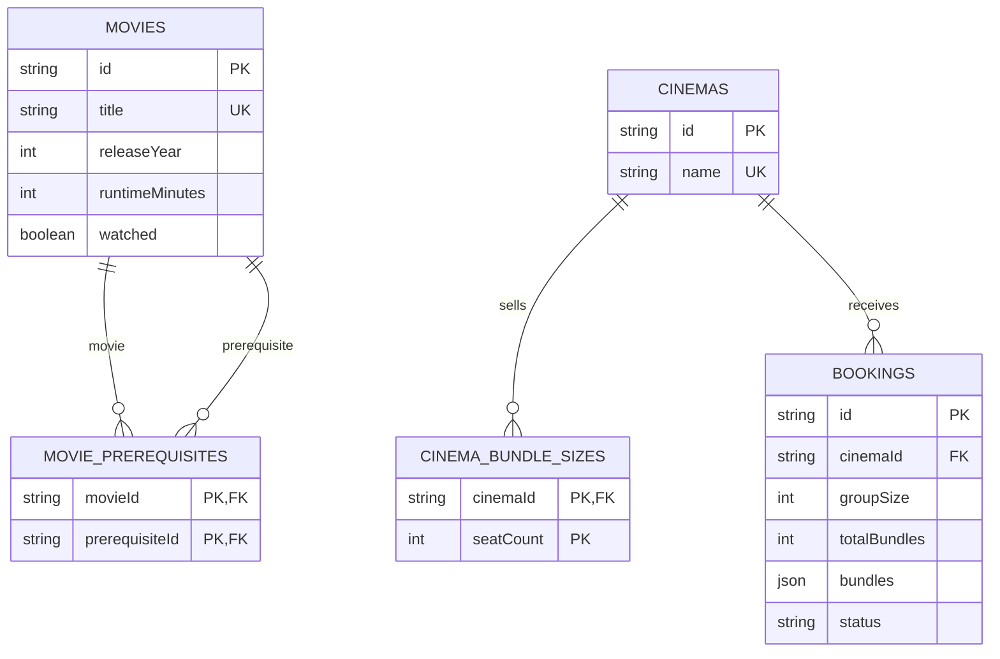

# CineQuest Client

<div align="center">
  
</div>

## Overview

CineQuest is a movie rewatch planning and cinema booking platform. It helps movie fans build a valid rewatch order from prerequisite links, track watched progress, calculate the fewest exact cinema bundles for a group, and manage opening-night bookings.

The product flow is: build the movie library, choose a target film, follow the computed rewatch path, then use the booking view to plan the premiere with the minimum number of cinema bundles.

This repository contains the React/Vite client application. It communicates with the CineQuest REST API for movies, cinemas, rewatch orders, quotes, and bookings. A shared top-level data cache keeps data available between routes, while background refresh keeps the UI current after create, update, cancel, and delete actions.

## Table of Contents

- [Tech Stack](#tech-stack)
- [Key Features](#key-features)
- [Dependencies](#dependencies)
- [Getting Started](#getting-started)
- [Environment Variables](#environment-variables)
- [Available Scripts](#available-scripts)
- [Project Structure](#project-structure)
- [Roles & Access Control](#roles--access-control)
- [Work Order Lifecycle](#work-order-lifecycle)
- [Metadata & SEO](#metadata--seo)
- [API Integration](#api-integration)
- [Deployment](#deployment)
- [Data Model](#data-model)
- [Relevant Links](#relevant-links)

## Tech Stack

- React 19 — component-based UI, routing integration, and local interaction state.
- TypeScript 7 — static typing for API payloads, forms, hooks, and components.
- Vite 7 — fast development server and production build tooling.
- Tailwind CSS 4 — utility-first styling for the responsive dark theme.
- React Router 7 — client-side routes for movies, rewatch plan, booking, booking list, and 404 handling.
- Sonner — success, error, and warning toast notifications.
- Biome — formatting and linting for client source files.

## Key Features

- Movies view for adding, editing, deleting, and marking movies as watched.
- Prerequisite selection with cycle-safe updates handled by the API and a confirmation step before deletion.
- Rewatch plan view with topological prerequisite order, watched ticks, progress bar, watched count, and remaining runtime.
- Booking view with cinema selection, group-size input, exact bundle quotes, and an explicit “Not possible” result for invalid group sizes.
- Booking creation from a valid quote, with a dedicated action to jump to the booking list.
- Booking list view with confirmed and cancelled states, cancel/delete confirmations, and disabled deletion for cancelled bookings.
- Cinema management from the booking view, including name and bundle-size updates with validation handled by the API.
- Shared cached data for movies, cinemas, bookings, and rewatch orders to avoid repeated skeleton loading on every route visit.
- Responsive layout with a sticky header, sticky side cards, and a hamburger menu on small screens.
- Per-page document titles, branded favicon, empty states, loading states, and accessible button feedback.

## Dependencies

### Runtime

| Package | Version | Purpose |
|---|---:|---|
| `react` | `^19.2.0` | UI component library |
| `react-dom` | `^19.2.0` | React rendering for the browser |
| `react-router-dom` | `^7.18.6` | Client-side routing and navigation |
| `sonner` | `^2.0.8` | Toast notifications |

### Development

| Package | Version | Purpose |
|---|---:|---|
| `@biomejs/biome` | `^2.5.15` | Formatting and linting |
| `@tailwindcss/vite` | `^4.3.5` | Tailwind CSS Vite integration |
| `@types/react` | `^19.2.0` | React TypeScript types |
| `@types/react-dom` | `^19.2.0` | React DOM TypeScript types |
| `@vitejs/plugin-react` | `^5.0.0` | React plugin for Vite |
| `tailwindcss` | `^4.3.5` | Utility-first CSS framework |
| `typescript` | `^7.0.2` | TypeScript compiler and type checking |
| `vite` | `^7.1.0` | Dev server and production bundler |

## Getting Started

Prerequisites:

- Bun installed locally.
- The CineQuest server running locally, or a reachable deployed API.
- Optional: Docker if you want to run the full stack from the workspace root.

```bash
bun install
cp .env.example .env
bun run dev
```

On Windows PowerShell:

```powershell
bun install
Copy-Item .env.example .env
bun run dev
```

The client runs at `http://localhost:3000`.

To run the full stack with the workspace Docker Compose file, start Docker from the workspace root containing both `cine-quest-client` and `cine-quest-server`:

```bash
docker compose up --build
```

That setup starts PostgreSQL, the API at `http://localhost:5000/api`, and the client at `http://localhost:3000`.

## Environment Variables

Environment variables are defined in `.env.example` and copied to `.env` for local development.

| Variable | Required | Description | Example |
|---|---|---|---|
| `VITE_API_BASE_URL` | Yes | Base URL for the CineQuest API | `http://localhost:5000/api` |

Example `.env`:

```env
VITE_API_BASE_URL=http://localhost:5000/api
```

For the deployed client, set the same variable to the production API URL:

```env
VITE_API_BASE_URL=https://cine-quest-server.vercel.app/api
```

Do not commit real environment files. Only `.env.example` should be tracked.

## Available Scripts

| Command | Description |
|---|---|
| `bun run dev` | Starts the Vite development server |
| `bun run build` | Type-checks and builds the production bundle |
| `bun run preview` | Previews the production build locally |
| `bun run typecheck` | Runs TypeScript type checking |
| `bun run format:check` | Checks source formatting |
| `bun run format:fix` | Formats source files |
| `bun run lint:check` | Checks lint rules |
| `bun run lint:fix` | Applies automatic lint fixes |

## Project Structure

```text
cine-quest-client/
├── public/
├── src/
│   ├── components/
│   ├── hooks/
│   ├── modules/
│   │   ├── booking/
│   │   ├── movies/
│   │   └── rewatch/
│   ├── pages/
│   ├── providers/
│   ├── views/
│   ├── api.ts
│   ├── App.tsx
│   ├── index.css
│   ├── main.tsx
│   └── types.ts
├── .env.example
├── index.html
├── package.json
└── vercel.json
```

| Path | Purpose |
|---|---|
| `src/main.tsx` | React application entry point |
| `src/App.tsx` | Route definitions and top-level providers |
| `src/api.ts` | Typed API wrapper using `fetch` |
| `src/types.ts` | Shared API and domain TypeScript types |
| `src/index.css` | Tailwind setup and global styles |
| `src/components/AppShell.tsx` | Header, navigation, footer, and page layout |
| `src/pages/` | Route-level page components |
| `src/views/` | Page-level composition of feature modules |
| `src/modules/movies/` | Movie library UI, form, validation, and hook |
| `src/modules/rewatch/` | Rewatch target panel, timeline, and hook |
| `src/modules/booking/` | Cinema list, quote card, booking form/list, and hook |
| `src/providers/AppDataProvider.tsx` | Shared cache for movies, cinemas, bookings, and orders |
| `src/providers/ConfirmProvider.tsx` | Confirmation dialog context |
| `src/hooks/` | Reusable hooks for titles, confirmations, dropdowns, and pagination |
| `src/components/skeletons/` | Loading placeholder components |
| `public/favicon.svg` | Branded favicon |
| `vercel.json` | SPA rewrite for deployed routes |

## Roles & Access Control

This assessment build is a public demo and does not include authentication, sessions, or role-based access control.

- All client routes are open to any visitor.
- Any visitor can add, edit, and delete demo movies, cinemas, and bookings.
- Destructive actions use confirmation dialogs and disabled buttons to prevent accidental changes.
- Cancelled bookings cannot be deleted from the booking list, preserving the cancellation history.
- Authorization would require backend authentication and role checks before it could be enforced in the UI.

If extended, a typical role model would be:

| Role | Intended Access |
|---|---|
| Guest | View movies, rewatch plan, and booking quotes |
| Member | Create and cancel bookings |
| Admin | Full movie, cinema, and booking management |

## Work Order Lifecycle

CineQuest does not have a separate work-order module. The closest operational workflow is the booking lifecycle.

1. **Select** a cinema and enter a group size on `/booking`.
2. **Quote** the group with `GET /api/cinemas/:id/booking?groupSize=N`.
3. **Review** the result. If `possible` is `false`, the UI shows an explicit impossible state and blocks confirmation.
4. **Confirm** a valid quote with `POST /api/cinemas/:id/booking`.
5. **Track** the booking on `/booking/list` with status `CONFIRMED`.
6. **Cancel** the booking with `PATCH /api/bookings/:id/cancel`; the status changes to `CANCELLED`.
7. **Delete** a confirmed booking with `DELETE /api/bookings/:id` when it should be removed permanently.

Movie and cinema management follow a separate administrative flow: create, update, and delete. Prerequisite updates are validated server-side to prevent cycles, and cinema deletion cascades to related bookings.

## Metadata & SEO

- `index.html` sets `lang="en"`, charset, responsive viewport, theme color `#070b18`, meta description, and the default title `CineQuest | Movies`.
- `public/favicon.svg` provides a branded film-strip icon.
- `src/hooks/usePageTitle.ts` sets a page-specific document title such as `Rewatch Plan | CineQuest`.
- Titles are applied on the Movies, Rewatch Plan, Booking, Booking List, and Not Found pages.
- React Helmet is intentionally not used; the lightweight hook keeps the bundle smaller.
- `vercel.json` rewrites all paths to `/index.html`, so direct navigation to client routes works after deployment.

## API Integration

- The API base URL comes from `VITE_API_BASE_URL` and defaults to `http://localhost:5000/api`.
- `src/api.ts` wraps all `fetch` calls, adds JSON headers, parses the success envelope, and throws readable errors for toasts.
- Successful API responses follow `{ success, statusCode, message, data, meta? }`.
- Errors are displayed through Sonner using the server `message` field.
- Movie and cinema data is cached in `AppDataProvider` and refreshed in the background after mutations.

Client integration map:

| Area | Client Calls |
|---|---|
| Movies | `list`, `create`, `update`, `remove`, `getRewatchOrder` |
| Cinemas | `list`, `update`, `remove`, `getBookingQuote`, `createBooking` |
| Bookings | `list`, `cancel`, `remove` |

Detailed backend contracts are documented in `API_INTEGRATION.md` in the `cine-quest-server` repository. The published Postman collection is listed under Relevant Links.

## Deployment

- Platform: Vercel.
- Build command: `bun run build`.
- Build output: `dist`.
- Required environment variable: `VITE_API_BASE_URL` pointing to the deployed API.
- `vercel.json` configures SPA fallback by rewriting all routes to `/index.html`.
- Production URL: https://cine-quest-client.vercel.app

Before deploying, run the local verification commands:

```bash
bun run typecheck
bun run format:check
bun run lint:check
bun run build
```

## Data Model



## Relevant Links

- Live client: https://cine-quest-client.vercel.app
- Live API: https://cine-quest-server.vercel.app/api
- Postman collection: https://documenter.getpostman.com/view/59636503/2sBYHbtcid
- Client repository: https://github.com/mdashraful24/cine-quest-client.git
- Server repository: https://github.com/mdashraful24/cine-quest-server.git
- Backend integration guide: `API_INTEGRATION.md` in the server repository
