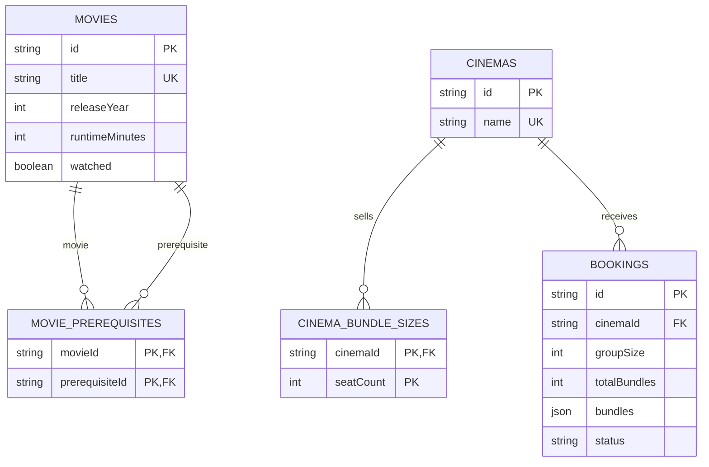

# CineQuest Client

## Overview

CineQuest is a movie rewatch planning and cinema booking platform. It helps movie fans build a valid rewatch order from prerequisite links, track watched progress, calculate the fewest exact cinema bundles for a group, and manage opening-night bookings.

The product flow is: build the movie library, choose a target film, follow the computed rewatch path, then use the booking view to plan the premiere with the minimum number of cinema bundles.

This repository contains the React/Vite client application. It communicates with the CineQuest REST API for movies, cinemas, rewatch orders, quotes, and bookings. A shared top-level data cache keeps data available between routes, while background refresh keeps the UI current after create, update, cancel, and delete actions.

## Screenshot

## Core Technologies

- React 19 — component-based UI, routing integration, and local interaction state.
- TypeScript 7 — static typing for API payloads, forms, hooks, and components.
- Vite 7 — fast development server and production build tooling.
- Tailwind CSS 4 — utility-first styling for the responsive dark theme.
- React Router 7 — client-side routes for movies, rewatch plan, booking, booking list, and 404 handling.
- Sonner — success, error, and warning toast notifications.
- Biome — formatting and linting for client source files.

## Key Features

- Movies view for adding, editing, deleting, and marking movies as watched.
- Prerequisite selection with cycle-safe updates handled by the API and a confirmation step before deletion.
- Rewatch plan view with topological prerequisite order, watched ticks, progress bar, watched count, and remaining runtime.
- Booking view with cinema selection, group-size input, exact bundle quotes, and an explicit “Not possible” result for invalid group sizes.
- Booking creation from a valid quote, with a dedicated action to jump to the booking list.
- Booking list view with confirmed and cancelled states, cancel/delete confirmations, and disabled deletion for cancelled bookings.
- Cinema management from the booking view, including name and bundle-size updates with validation handled by the API.
- Shared cached data for movies, cinemas, bookings, and rewatch orders to avoid repeated skeleton loading on every route visit.
- Responsive layout with a sticky header, sticky side cards, and a hamburger menu on small screens.
- Per-page document titles, branded favicon, empty states, loading states, and accessible button feedback.

## Dependencies

### Runtime

| Package | Version | Purpose |
|---|---:|---|
| `react` | `^19.2.0` | UI component library |
| `react-dom` | `^19.2.0` | React rendering for the browser |
| `react-router-dom` | `^7.18.6` | Client-side routing and navigation |
| `sonner` | `^2.0.8` | Toast notifications |

### Development

| Package | Version | Purpose |
|---|---:|---|
| `@biomejs/biome` | `^2.5.15` | Formatting and linting |
| `@tailwindcss/vite` | `^4.3.5` | Tailwind CSS Vite integration |
| `@types/react` | `^19.2.0` | React TypeScript types |
| `@types/react-dom` | `^19.2.0` | React DOM TypeScript types |
| `@vitejs/plugin-react` | `^5.0.0` | React plugin for Vite |
| `tailwindcss` | `^4.3.5` | Utility-first CSS framework |
| `typescript` | `^7.0.2` | TypeScript compiler and type checking |
| `vite` | `^7.1.0` | Dev server and production bundler |

## Run Locally

Prerequisites:

- Bun installed locally.
- The CineQuest server running locally, or a reachable deployed API.
- Optional: Docker if you want to run the full stack from the workspace root.

```bash
bun install
cp .env.example .env
bun run dev
```

On Windows PowerShell:

```powershell
bun install
Copy-Item .env.example .env
bun run dev
```

Environment configuration:

| Variable | Required | Description |
|---|---|---|
| `VITE_API_BASE_URL` | Yes | Base URL for the CineQuest API, for example `http://localhost:5000/api` |

Example `.env`:

```env
VITE_API_BASE_URL=http://localhost:5000/api
```

The client runs at `http://localhost:3000`.

To run the full stack with the workspace Docker Compose file, start Docker from the workspace root containing both `cine-quest-client` and `cine-quest-server`:

```bash
docker compose up --build
```

That setup starts PostgreSQL, the API at `http://localhost:5000/api`, and the client at `http://localhost:3000`.

## Useful Commands

| Command | Description |
|---|---|
| `bun run dev` | Starts the Vite development server |
| `bun run build` | Type-checks and builds the production bundle |
| `bun run preview` | Previews the production build locally |
| `bun run typecheck` | Runs TypeScript type checking |
| `bun run format:check` | Checks source formatting |
| `bun run format:fix` | Formats source files |
| `bun run lint:check` | Checks lint rules |
| `bun run lint:fix` | Applies automatic lint fixes |

## Live Links

- Live client: https://cine-quest-client.vercel.app
- Live API: https://cine-quest-server.vercel.app/api
- Client repository: https://github.com/mdashraful24/cine-quest-client.git
- Server repository: https://github.com/mdashraful24/cine-quest-server.git

## Data Model



## AI Usage

AI tools were used for requirement extraction, implementation review, edge-case planning, and documentation drafting. The final implementation was reviewed manually, with the rewatch-order and bundle-optimization logic implemented directly in the server repository.
