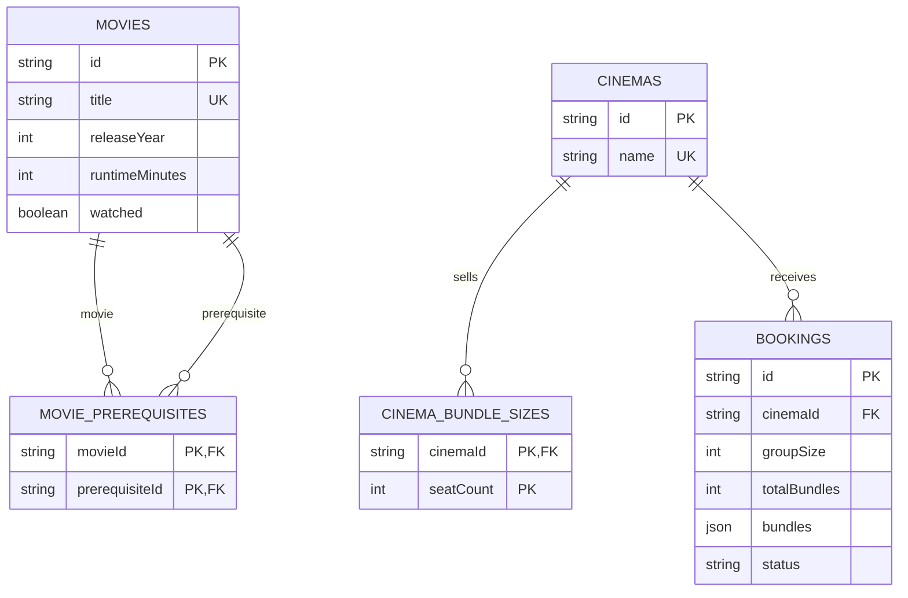

# CineQuest Client

CineQuest is a movie rewatch planning and cinema booking platform that helps fans discover watch orders, track their progress, and organize opening-night group bookings.

Built with Vite, React, TypeScript, Tailwind CSS, and React Router.

## Movies View (`/movies`)

- Add a movie with title, release year, runtime, prerequisites, and watched state.
- Edit prerequisites from the movie library.
- Tick movies as watched.
- Delete movies with a confirmation step.

## Rewatch Plan View (`/rewatch`)

- Pick a target movie.
- See prerequisites in rewatch order with watched ticks.
- Track progress as “X of Y watched” with a progress bar.
- See remaining watch time for unwatched prerequisites.

## Booking View (`/booking`)

- Pick a cinema and enter a group size.
- See the exact bundles to buy or an explicit “Not possible” result.
- Confirm bookings and jump to the booking list from a dedicated button.
- Delete cinemas with a confirmation step.
- See remaining rewatch time for the selected target movie.

## Booking List View (`/booking/list`)

- Review confirmed and cancelled bookings.
- Cancel or delete bookings with a confirmation step.

## Run Locally

```bash
bun install
cp .env.example .env
bun run dev
```

On Windows PowerShell, use `Copy-Item .env.example .env`.

The client runs at `http://localhost:3000`. Set `VITE_API_BASE_URL` to the backend API base URL.

## Useful Commands

```bash
bun run typecheck
bun run build
bun run format:check
bun run lint:check
```

## Docker Compose

From the workspace root containing both `cine-quest-client` and `cine-quest-server`:

```bash
docker compose up --build
```

This starts PostgreSQL, the API at `http://localhost:5000/api`, and the client at `http://localhost:3000`.

## Data Model



## AI Usage

AI tools were used for requirement extraction, implementation review, edge-case test planning, and documentation drafting. The final code was reviewed manually, and the rewatch-order and bundle-optimization logic was implemented directly in the repository.
